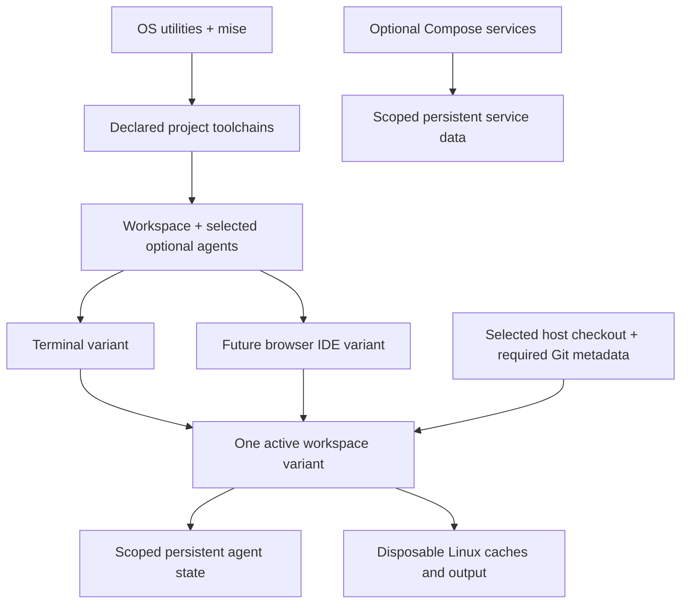

# Architecture decisions

[Overview](../README.md) · [Milestone 1](milestone-1.md) · [Roadmap](roadmap.md)

**Status:** design accepted 2026-09-09; fixture foundation and optional omp layer implemented with macOS arm64 evidence. The [native LiteLLM fixture proof](m1-apple-silicon-evidence-v2.md) verifies authenticated assisted work and saved-session resume. Bedrock authentication and Argus acceptance remain pending. Targets: Apple Silicon macOS and Windows/WSL2; the latter is unverified and Argus's work-laptop platform is unconfirmed.

## Shared foundation

The future IDE variant shares the terminal variant's toolchain/agent stages and runs its terminal in that environment. Compose profiles select services, not image packages. GUI and voice remain future capabilities.

## ADR-001: Host source and explicit persistence

**Status: Accepted.** Host tools need access to source while containers remain disposable.

**Decision:** bind-mount only the selected checkout and required Git metadata. Preserve resolved host paths inside the container. Discover metadata through Git; validate both absolute and relative worktree links, including the common Git directory. Do not rewrite Git pointers on startup or expose the whole host home/repository collection.

| Data | Placement and lifecycle |
| --- | --- |
| Source, index, untracked work, Git/worktree metadata | Existing host storage; never deleted by Hestia lifecycle operations |
| Selected agent configuration, sessions, credentials | Explicit persistent location per workspace and agent, outside source/build context |
| Database and other service data | Workspace-scoped persistent volumes by default; shared data requires an explicit choice |
| Linux dependencies and reproducible output | Workspace-scoped disposable Docker volumes, separate from native host artifacts |
| Temporary files | Disposable container storage |

Classify data by recoverability: agents can mix credentials, sessions, and caches in one directory. Define artifact paths or overlays per project so native and Linux outputs do not overwrite each other. Installed image tools live outside persisted state mounts so old state cannot hide updates.

**Consequences:** host and container edits affect the same source, including deletions. Coordinate writes to one checkout; independent agents should use separate worktrees. Worktrees share Git metadata and are not mutually untrusted security boundaries. Measure bind-mount performance before changing storage; prefer WSL Linux filesystem source placement on Windows. Source in managed volumes is an alternative with extra friction for host tools.

Ownership handling must reflect the runtime: host and container UIDs need not match. Validate effective write access and never recursively chown host source as a repair. Persistence protects against container removal, not disk loss or storage deletion.

## ADR-002: Checkout identity and resource scope

**Status: Accepted design.** Matching repository names and sibling worktrees must not collide.

**Decision:** repository identity groups checkouts by canonical common Git directory; workspace identity uses the canonical checkout path. Derive a Compose project name using a sanitized, length-bounded label and deterministic path hash: `hestia-<label>-<hash>`. The implemented label is capped at 24 characters; the hash is the first 12 lowercase hex characters of SHA-256 over the UTF-8 canonical path without a trailing newline ([exact encoding](../identity/README.md#exact-encoding)). Check the full recorded path before reusing existing state to detect collisions.

Use this identity consistently for containers, networks, caches, and agent/service state. Let Compose namespace resources; avoid fixed container names and globally named volumes. Branch, tool, agent, or future IDE variant changes preserve identity. Different checkout paths receive different identities. Do not use remote URLs or branch names as identity. Handle host-port conflicts separately; resource naming does not namespace host ports.

**Consequences:** moving a checkout changes identity; preserve old state for explicit, validated reattachment. IDs are local, not shared team identifiers. Names alone collide; random IDs require registration/recovery machinery. No registry or automatic move tracking is required.

## ADR-003: Build-time tools and optional interfaces

**Status: Accepted design.** Optional functionality must share a foundation rather than develop competing installation paths.

**Decision:** use one Dockerfile/build route with reusable stages or named targets. The base contains OS utilities and mise; project layers install declared tools and selected optional agents. Record versions and appropriate upstream verification evidence per architecture. Application dependency lockfiles remain authoritative; mise lock guarantees vary by backend and must be checked.

Normal startup installs or upgrades no tools. Declaration changes require an explicit build/update. Keep trusted build manifests separate from arbitrary project code; mounting a repository does not automatically authorize its hooks, tasks, or mise configuration. Preserve native trust controls. Never include credentials or agent login state in build contexts.

Run one workspace variant per checkout by default. A future IDE variant adds an IDE to the same project/agent environment, retaining source and persistent state when switching variants. Independent project services remain separate Compose services.

**Consequences:** builds need downloads; warm startup is predictable. Shared declarations do not prove byte-for-byte reproducibility. No universal toolchain image or mandatory service stack is required.

Current implementation: Debian bookworm-slim, pinned mise and a non-root `dev` user; the `fixture-tools` target installs only the synthetic fixture's Go declaration. Mounting another repository does not build its toolchain. The optional `agent` target adds pinned omp and the `pig` target adds pinned PiG; opt-in `pi`, `pi-bolt` and `claude-code` targets add upstream Pi, Pi-Bolt and Claude Code the same way. All build on a shared `nono` stage carrying the pinned nono sandbox CLI, which is inert until invoked. Only linux/arm64 has been exercised; every target builds there, but no agent has run under nono or in the new images. See [evidence](evidence.md) for versions and verification boundaries.

## ADR-004: Native authentication and scoped agent state

**Status: Accepted.** Preserve sessions with scoped credentials and native agent controls.

**Decision:** run the selected agent directly with its native login, permission, trust, and session mechanisms. Persist only required state per workspace and agent. Inspect supported paths and credential-refresh behavior before choosing concrete mounts. Do not share one writable agent home between concurrent workspaces by default.

Keep Git authentication separate: use a scoped credential helper or supported SSH-agent forwarding where practical, not a broad SSH-directory mount. Supply API keys at runtime; prefer service-scoped secret files where supported. If a tool requires environment variables, document that limitation without claiming they are hidden from container inspection. Credential values must not enter generated Compose files, tracked manifests, build arguments, logs, or evidence reports.

**Consequences:** some workspaces need separate login. Deliberate credential sharing can follow a demonstrated need. Agents can access credentials supplied to them; containerization adds no separate protection against that authorized access. Logout/revocation must preserve source and unrelated sessions. Back up useful state; prefer reauthentication on restore. If required state mixes credentials with sessions, treat its backup as sensitive and encrypt it. Full backup/restore follows the pilot.

[ADR-006](#adr-006-three-step-start) makes upstream Pi the default agent, with one login per user. The rest of this section describes the opt-in omp integration. `~/.omp` is workspace-scoped writable state; root-owned `/opt/hestia/omp/config.yml` loads through `PI_CONFIG_FILES` after global/project settings and before runtime overrides. This upstream overlay mechanism replaces the read-only settings bind that broke atomic settings writes. It is not a security boundary against control of the process environment or runtime overrides. Settings persistence is exercised; real Bedrock credential-chain use remains unverified. The explicit LiteLLM attach opt-in passes authenticated fixture edits, recreation and native saved-session resume; see the [native LiteLLM fixture proof](m1-apple-silicon-evidence-v2.md).

## ADR-005: Lifecycle preserves work

**Status: Accepted design.** Runtime cleanup must be independent of user-data deletion.

| Operation | Contract |
| --- | --- |
| Start | Check recorded identity, Compose config and local image before creating/starting the workspace |
| Attach | Open another terminal in the existing workspace |
| Stop | Stop processes; retain runtime resources and persistent data |
| Remove container | Remove runtime resources; preserve source, state and persistent volumes |
| Rebuild/recreate | Build explicitly; recreate preflights identity, Compose config and local image before stopping/removing runtime; preserve durable data |
| Clear caches | Perform the same preflight, then delete only the selected workspace's identified disposable cache volume and restart |
| Delete workspace state | Separate destructive action that previews and confirms precisely named resources |

`workspace/workspace-lifecycle.sh` implements validate/start/attach/stop/remove-runtime/recreate/clear-caches over Compose; `validate` runs the same preflight without runtime mutation. Builds remain explicit Docker operations. Preflight failure leaves the existing runtime and caches alone; it does not guarantee recovery from a later runtime failure. Finish active work before recreation or cache clearing. Routine operations never perform global prune, implicit volume deletion, or source deletion. Destructive state-deletion automation remains deferred.

Tests use unique disposable identities and synthetic storage, never production resources. Cache clearing must leave source/Git and selected durable state unchanged.

## ADR-006: Three-step start

**Status: Accepted requirement 2026-10; not implemented.** A product review found that reaching an agent prompt took about ten expert steps (build, generate, validate, start, attach, trust, toolchain, login), and had no supported path to a real repository's toolchain. The architecture above stays; the user no longer assembles it.

**Decision:** the user journey is at most three steps after Docker is installed:

1. Install Hestia with one copy-paste command that puts `hestia` on `PATH`.
2. Run `hestia` in any checkout (or `hestia <path>`).
3. Tell the agent what to do. The first run of the agent also asks for its native login (pi `/login`).

`hestia` is one thin launcher script over the existing helpers, not a CLI framework. Each run resolves the checkout, builds the default image if it is missing, writes the generated Compose file into the workspace state directory, starts the workspace when it is stopped, and opens the agent in the checkout. Running it again re-attaches. Expert operations stay in the existing helpers, which use the same generated file.

This amends earlier decisions:

- **Default agent is upstream Pi** (the `pi` target). omp, PiG and Claude Code stay opt-in images. Pi supports Bedrock through ambient AWS credentials, so Bedrock remains available to the Argus pilot.
- **Login once per user, not once per repository** (amends ADR-004). One Hestia-owned agent home (not the host home) is bound into every workspace. Pi stores credentials in `~/.pi/agent/auth.json` and keys sessions by working directory. Hestia preserves checkout paths, so sessions stay per checkout. Pi 1.5.0 source serializes `auth.json` and `settings.json` writes with a `proper-lockfile` lock and re-checks an OAuth token under that lock before refreshing; the 1.4.0 image binary contains the same code. Two workspaces refreshing at once has not been run, and the lock is a directory made with `mkdir` on a bind mount, which is unverified across containers on Docker Desktop.
- **Launching a checkout trusts that checkout's mise configuration**, and nothing else (amends ADR-003). Running `hestia` in a repository is the user's consent. Trust is scoped to that path and survives recreation.
- **The first start installs the toolchain the checkout declares** into a persistent, rebuildable tool cache, then reuses it (amends ADR-003 "startup installs no tools"). Later starts install only after declarations change. Startup never silently upgrades installed tools.

Prebuilt published images, desktop installers and agent choice prompts are deferred until the local build path proves too slow or too hard.

**Consequences:** the first launch is slow (image build and toolchain install). A repository's mise configuration runs with the user's consent but without a separate review step. A shared agent home means every workspace can use that credential. It also means an agent in one workspace can change settings or install extensions that run in every other workspace. Identity, mounts, persistence and lifecycle contracts are unchanged.

## Remaining implementation choices

- User/work laptop: OS/CPU, available runtime and Argus build/tests/services. Argus remains employer-local.
- Provider acceptance: the native LiteLLM fixture journey passes; real Bedrock credentials/login/refresh and employer-local agent configuration remain unverified. The existing default overlay and separate Git authentication remain.
- ADR-006 launcher: install command and location, shared agent-home layout, the tool-cache volume, and checks for concurrent login refresh.
- Later: project services, backup mechanism and broader Windows/WSL2 matrix. No broader support/performance claims are established here.

## Primary references

- [Docker bind mounts](https://docs.docker.com/engine/storage/bind-mounts/) and [filesystem performance](https://code.visualstudio.com/remote/advancedcontainers/improve-performance)
- [Git worktree metadata](https://git-scm.com/docs/git-worktree)
- [Compose project names](https://docs.docker.com/compose/how-tos/project-name/), [profiles](https://docs.docker.com/compose/how-tos/profiles/) and [secrets](https://docs.docker.com/compose/how-tos/use-secrets/)
- [Multi-stage builds](https://docs.docker.com/build/building/multi-stage/) and [mise lock limits](https://mise.jdx.dev/dev-tools/mise-lock.html)

`container-dev-env` is read-only reference; its backlog and agent framework are not inherited.
